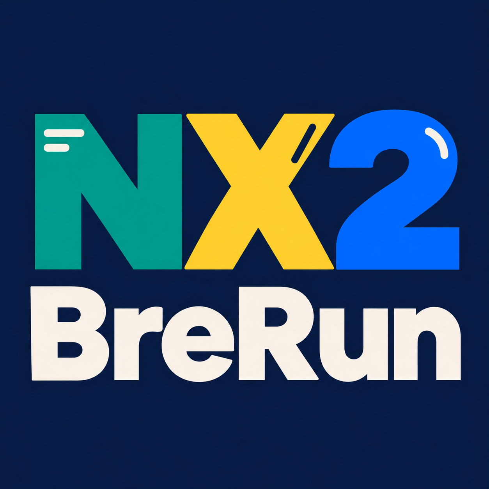

# NX2 BreRun



Homebrew launcher for running Nintendo Switch 2 game backups in NUP format.

It scans the SD card, shows a gallery of game dumps, and launches compatible titles using the nx2-relink runtime. It reads NUP files directly from the SD card without creating a separate NRO or RomFS image for each game. Use dumps of games you own.

## Install on Switch 2

Choose one installation path. IZ2S also scans `SD:/switch/`, so installing both copies can create two entries in its library.

### kaiHEN and Homebrew Menu

1. Create `SD:/switch/nup-library/` on the console's SD card.
2. Copy `nup-library.nro` into that directory. The complete path is `SD:/switch/nup-library/nup-library.nro`.
3. Open **NX2 BreRun** in Homebrew Menu.

### IZ2S Launcher

1. Extract `nup-library.zip` into the **root of the SD card**. The `iz2s/` directory from the archive goes at the top level of the card.
2. Check that the program is at `SD:/iz2s/modules/nup-library/launcher.nro`.
3. Open **NX2 BreRun** in the IZ2S app library. Refresh or reopen the library if the entry is missing.

To install manually from the standalone NRO, create `SD:/iz2s/modules/nup-library/` and copy the file there as `launcher.nro`.

## Add games

- Put `.nup` files anywhere on the SD card. `SD:/Games/` is a convenient location. Keep all consecutive parts of a split dump together, for example `game.nup.00`, `game.nup.01`, or `dump.001`, `dump.002`.
- A game folder can contain `romfs.bin` or `romfs.bin.00`, `romfs.bin.01`, and the remaining consecutive parts. To launch it, the same folder needs the original executable modules and `main.npdm` inside `exefs/`.
- The scanner finds NUPs by their headers and skips `.nro` files. It displays the title and artwork embedded in the dump when available. Use a sibling `game.nup.jpg` or `game.nup.png` for a NUP without artwork. For an unpacked game folder, use `cover.jpg`, `cover.png`, `icon.jpg`, or `icon.png` and optionally `title.txt` for the display name.
- For both NUPs and unpacked games, NX2 BreRun creates `nup-<title-id>/` next to the NRO you launched. Logs are in that directory and saved data is in its `save/` subdirectory.

| Launch location | Saved data |
| --- | --- |
| **kaiHEN / Homebrew Menu** | `SD:/switch/nup-library/nup-<title-id>/save/` |
| **IZ2S module** | `SD:/iz2s/modules/nup-library/nup-<title-id>/save/` |

To carry over a previous save, copy its `save/` folder into the matching `nup-<title-id>/` directory beside the NRO you use.

## Build from source on Linux

Install Bash, Python 3 with Pillow, GNU Make, and the [devkitPro toolchain with ounce-devkit](https://github.com/ouncebrew/ounce-devkit). The SDK directory must contain devkitA64, libounce, the Switch 2 EGL/GLES libraries, and the `nacptool` and `elf2nro` tools. Install Noto Sans Regular, Noto Sans Bold, and Noto Sans CJK Bold. The default font paths match Arch Linux. Use `IZ2S_REGULAR_FONT`, `IZ2S_UI_FONT`, and `IZ2S_CJK_FONT` for other paths.

Prepare the following sources on your build machine.

- Extract [nx2-relink v0.1.12](https://github.com/Olmectron/nx2-relink/releases/tag/v0.1.12). `NX2_RELINK_SOURCE` must point to the directory with its `runtime/` subdirectory.
- Extract [Zstandard v1.5.7](https://github.com/meta/zstd/releases/tag/v1.5.7). Set `ZSTD_SRC` to its source directory.
- Put [`stb_image.h` v2.30](https://github.com/nothings/stb/blob/master/stb_image.h) in a directory of your choice and set `IZ2S_STB_INCLUDE` to that directory.

From the repository root, substitute your paths and run the following commands.

```bash
export DEVKITPRO=/opt/devkitpro
export NX2_RELINK_SOURCE=/path/to/nx2-relink-0.1.12
export IZ2S_STB_INCLUDE=/path/to/stb-headers
export IZ2S_PYTHON=python3
ZSTD_SRC=/path/to/zstd-1.5.7
toolchain="$DEVKITPRO/devkitA64/bin/aarch64-none-elf"

make -C "$ZSTD_SRC/lib" libzstd.a \
  CC="$toolchain-gcc" AR="$toolchain-ar" \
  CFLAGS="-O2 -march=armv8-a+crc+crypto -mtune=cortex-a57 -mtp=soft -fPIE" \
  ZSTD_LIB_COMPRESSION=0 ZSTD_NO_ASM=1 ZSTD_LEGACY_SUPPORT=0

export IZ2S_ZSTD_INCLUDE="$ZSTD_SRC/lib"
export IZ2S_ZSTD_LIB="$ZSTD_SRC/lib/libzstd.a"
./build.sh --release
```

Use a clean output directory. The release build writes `nup-library.nro` and `nup-library.zip` into `dist/`. Pass a directory as the next argument to change the destination. The build generates the font atlas and converts the high-resolution PNG in `assets/icon.png` to a 256 × 256 JPEG for the NRO. It uses no dumps, keys, or firmware files.

## Credits and notices

The runtime is adapted from Olmectron's [nx2-relink](https://github.com/Olmectron/nx2-relink). See [LICENSE](LICENSE) for third-party notices.
